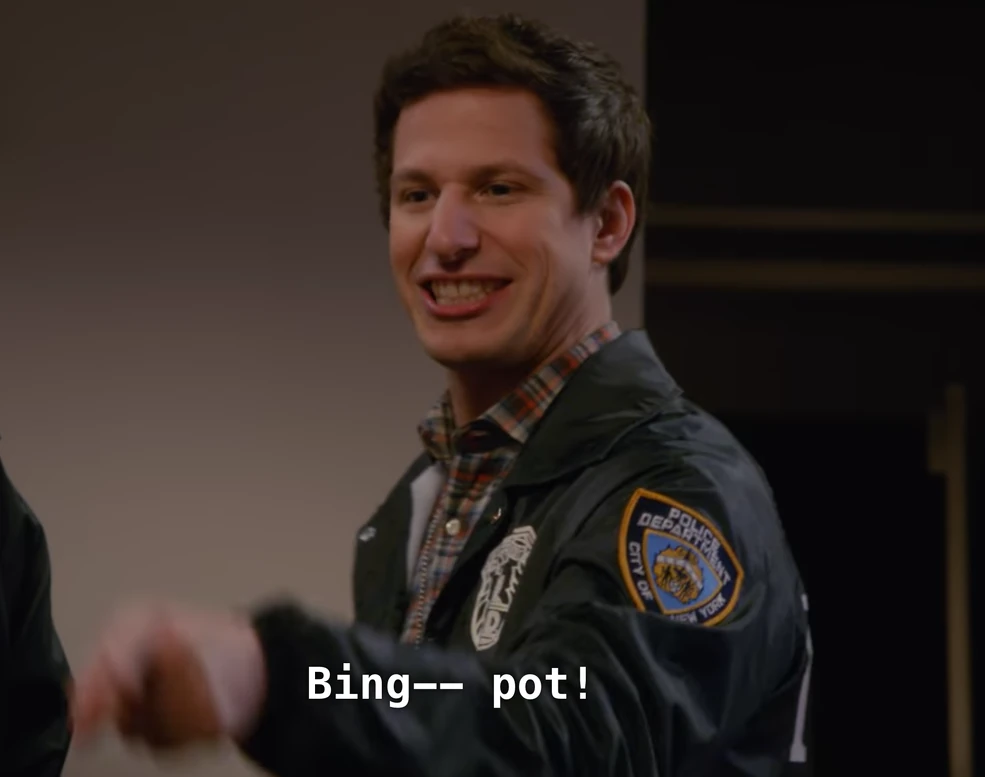

<<<<<<< HEAD
<div align="center">

# Team BingPot!

**Camera-only race car localization**



<sub><i>Our filter, the moment the start position locks in: "Bing-- pot!"</i><br>
(Bingo + jackpot, from <a href="https://brooklyn99.fandom.com/wiki/File:Holt_Bingpot.gif">Brooklyn Nine-Nine</a>)</sub>

</div>

<br>

Estimate the pose of a race car (`x`, `y`, `yaw` in the track frame) from its onboard cameras and its speed and yaw-rate
signals, at camera rate (10 Hz), with no initial pose. Built for the Constructor Labs challenge.

<br>

<table>
  <tr>
    <td width="50%" valign="top" align="center">
      <h2>Vidya Sagar Vepa</h2>
      <sub>M.Sc. Automotive Engineering, RWTH Aachen</sub>
      <p>Applies deep learning and automation to physical systems.<br>
      Experience from Johnson Electric (R&amp;I) and Ola Electric (testing and validation).</p>
      <p><i>Open to master thesis roles.</i></p>
      <p><a href="https://linkedin.com/in/vidya-sagar-vepa">LinkedIn</a></p>
    </td>
    <td width="50%" valign="top" align="center">
      <h2>Shubhangee Singhal</h2>
      <sub>M.Sc. Automotive Engineering, RWTH Aachen</sub>
      <p>Focused on vehicle dynamics, active safety and model-based development.<br>
      Experience in powertrain calibration (Maruti Suzuki) and MBSE research (RWTH IMSE).</p>
      <p><i>Open to internships and master thesis roles.</i></p>
      <p><a href="https://linkedin.com/in/shubhangee-singhal">LinkedIn</a></p>
    </td>
  </tr>
</table>

<br>

## For the jury

To localise your own recording with our trained model, follow **[JURY_README.md](JURY_README.md)**: download the model,
install the requirements, run one command with the path to your `.mcap`, and get the pose CSV.

## Reproduce our results

To train the model yourself from the organisers' training recording and re-create the validation score, follow
**[REPRODUCE.md](REPRODUCE.md)**.
=======
# Camera-Only Race Car Localization — Neural Visual EKF

> **Jury:** start with [`JURY_README.md`](JURY_README.md). It lists every submission item and the exact commands
> to reproduce the pose files.

Estimate the pose of a race car (`constructor0/base_link`) in the track frame `map` — position
`x`, `y` and heading `yaw` — from the onboard cameras, at camera rate (10 Hz). The training run is a night
session at Yas Marina North (constructor0, 2026-10-13), laps up to ~40 m/s including a pit-lane pass. The
test run is one daylight lap at higher speed.

## Latest validation result

Tag `rmse-2.740-vidya-2026-10-18-1712`. Model `checkpoints/racing_model_val.pt`, evaluated on two laps of the
training run that it never saw (frames 4777–6975, 220 s), **without an initial pose** and with telemetry odometry.

| metric | value |
|---|---|
| **position RMSE [m]** | **2.740** ← score (lower is better) |
| position median / p95 [m] | 0.944 / 7.399 |
| lateral / longitudinal RMSE [m] | 2.040 / 1.829 |
| yaw RMSE [deg] | 0.872 |
| within 0.25 / 0.5 / 1 / 2 / 5 m | 5.1 / 15.5 / 53.3 / 84.2 / 90.6 % |
| coverage (1 s bins) | 100 % of the validated span |
| start-up (first 60 frames, before the start position is committed) | RMSE 5.24 m, then 2.64 m |

Same formulas as the organisers' `tools/evaluate.py`; reproduce with the organisers' scorer as shown in
[`JURY_README.md`](JURY_README.md#4b-held-out-validation-laps-with-ground-truth). Figures are in `results/validation/`,
the training curve in `results/figures/training_progress.png`.

## Rules this solution follows

| Rule (organisers) | How it is met |
|---|---|
| Causal: a pose at time `t` uses only images stamped `<= t` | `select_causal_image` (shared by dataset builder and inference) takes, per camera, the newest image with `stamp <= t`. Telemetry is integrated only from samples that have already arrived. |
| **No initial pose is given** | None is used. `MultiStartLocalizer` finds the start position from the images (see below). |
| Ground truth is for development and scoring only | `/tf` is read only by the training-set builder and the offline tools. `Scripts/3_causal_infer.py` never reads `/tf`. |
| Telemetry: speed, accelerations and yaw rate from `/constructor0/state_estimation` may be used, **pose fields may not** | `TelemetryTrack` (in `Scripts/1_build_dataset.py`) reads exactly four fields: `v_mps`, `wz_radps`, `ax_mps2`, `ay_mps2`. The pose fields (`x_m`, `y_m`, `yaw_rad`, `sn_map_state`, ...) are never accessed. |
| The shared daylight example must not be used to train, pre-train, tune or validate | It is not used for any of these. Validation laps come from the training run only (`--val-mode block`). The only file that reads it is `presentation/prepare_assets.py`, which extracts one frame as a slide illustration of the test domain (`presentation/assets/day_sample.jpg`). |
| Public external datasets and pre-trained models are allowed but must be declared | See **Declared external resources** below. |

## Declared external resources

| Resource | Where | Used for |
|---|---|---|
| ResNet-18, ImageNet-1k weights (`torchvision.models.ResNet18_Weights.DEFAULT`) | torchvision | Initialization of the shared place encoder and of the motion network. The first conv layer is averaged to one input channel; everything is then fine-tuned on the training run. |

**External datasets:** none. All training data comes from the training run.

## Approach

### 1. Build dataset — `Scripts/1_build_dataset.py`

Reads the MCAP bag and produces a synchronized cache (`data/training_cache.h5`).

- Decodes the four front/front-side cameras (`camera_fl`, `camera_fr`, `camera_cl`, `camera_cr`) to
  grayscale, crops the track band (18 %–74 % of height), resizes to 256×128.
- Anchors a causal multi-camera sample on every `camera_fl` frame, recording the per-camera image age.
- Interpolates the ground-truth pose (`/tf`) at each anchor stamp for **training labels only**.
- Integrates the telemetry (speed + yaw rate) between consecutive anchors into a body-frame motion
  `(dx, dy, dyaw)` and prints how it compares with ground truth (units, signs and scale are checked here).

### 2. Train model — `Scripts/2_train_model.py`

`RacingLocNet`: a shared ResNet-18 encodes the four cameras (learned per-camera attention gate) into a
256-D place descriptor; an auxiliary head regresses pose to structure the embedding; a second, early-fusion
network sees two consecutive frames stacked and predicts motion with its own uncertainty (the fallback odometry).

- Place loss pulls descriptors of the same place on different laps together; batches are built so that
  every anchor has a same-place partner from another lap.
- Appearance augmentation (gamma, exposure, haze, sky glow, shadows, blur) for robustness to a different time of day.
  No geometric augmentation, because the camera mount is fixed and the pose is encoded in the image geometry.
- Validation: two full laps from the middle of the training run (`--val-mode block`), with a 5 s guard on each side
  kept out of training and out of the map. Per-epoch metrics go to `<checkpoint>_history.csv`.
- The checkpoint bundles weights, the **place database** (descriptors + poses of all training frames), track borders
  and the validation block.

### 3. Causal inference — `Scripts/3_causal_infer.py`

A causal EKF on SE(2) `[x, y, yaw]` at 10 Hz.

- **Motion model.** Dead reckoning from telemetry speed and yaw rate, integrated at the telemetry rate between
  two camera stamps. The learned VO is used only when the telemetry is missing, stale or out of range. It was trained
  on night images, so a disagreement with the telemetry is logged but never switches the motion source.
- **Measurement.** Place retrieval gated around the predicted pose, similarity-weighted pose of the best matches, noise
  inflated when the match is weak (judged against the session's own recent good matches).
- **Finding the start.** No initial pose is given. Up to 96 of the best-matching map entries (at least 20 m apart) are
  tracked as parallel candidate starts for 1.5–6 s. Each is scored by its image similarity along the way and by whether
  its dead-reckoned path stays on the mapped track; the best one is committed to. Afterwards, a confident match far
  outside the gate relocalizes the filter globally.
- **Settings.** The defaults are the values `Scripts/4_diagnostics.py --sweep` chose on the held-out laps
  (`diagnostics/recommended_args.txt`), so no extra flags are needed.

Writes `submission.csv` (`timestamp_ns,x,y,yaw`, one pose per `camera_fl` frame) and a per-frame telemetry CSV.

### 4. Diagnostics — `Scripts/4_diagnostics.py`

An offline analysis tool that **uses ground truth on purpose**, so it is never part of the submission path. It replays the
real filter classes on the held-out laps (finding the start from the images, as in the competition), reports error
by variant, odometry accuracy, start-finding quality and filter consistency, and `--sweep` picks filter settings.

## Repository layout

| path | |
|---|---|
| `Scripts/1_build_dataset.py` | MCAP → synchronized HDF5 cache, telemetry integrator |
| `Scripts/2_train_model.py` | `RacingLocNet` training + place database → checkpoint |
| `Scripts/3_causal_infer.py` | causal EKF inference, autonomous start → `submission.csv` |
| `Scripts/4_diagnostics.py` | offline GT-assisted diagnostics + parameter sweep (not in submission path) |
| `tools/extract_gt.py`, `tools/evaluate.py` | the organisers' ground-truth export and scorer (unchanged) |
| `tools/gt_window.py` | cut the ground truth to a pose file's time span, so `tools/evaluate.py` can score the validation laps |
| `tools/plot_training.py`, `tools/visualize.py` | training curves; trajectory, error plots, metrics |
| `results/` | validation pose files, metrics and figures, training curve |
| `diagnostics/` | filter sweep results and the chosen settings |
| `presentation/` | slide deck (`project-overview.pptx` / `.pdf`) and the scripts that build it |
| `JURY_README.md` | submission checklist and reproduction commands |
| `brainstorming_and_diagnostics.md` | problem → diagnosis → fix → benefit log of every milestone |
| `chats/` | debugging walkthroughs that drove each improvement |

> Large files (`data/`, `checkpoints/*.pt`) are not in Git; see `JURY_README.md` for where to put them.

## Quick run

```bash
pip install -r requirements.txt

python Scripts/1_build_dataset.py data/c0_2026-10-13_22-53-42_camloc_0.mcap --output data/training_cache.h5
python Scripts/2_train_model.py --checkpoint checkpoints/racing_model_val.pt          # validation model
python Scripts/4_diagnostics.py --sweep --checkpoint checkpoints/racing_model_val.pt  # filter settings
python Scripts/2_train_model.py --full-train --checkpoint checkpoints/racing_model.pt # submission model
python Scripts/3_causal_infer.py <test.mcap> --checkpoint checkpoints/racing_model.pt --output submission.csv
```

All commands, including scoring and figures, are in [`JURY_README.md`](JURY_README.md).

## Metric

`position RMSE [m] = sqrt(mean(dx^2 + dy^2))` is the score — lower is better. Errors are split into the
GT car frame (longitudinal along heading, lateral across it). A submission needs ≥ 90 % coverage of the
1 s bins of the run to be ranked. See `data/README.md` for the full dataset, topic, and metric reference.

## Milestones (history)

Scored milestones are annotated git tags (`git tag -n3`); the tag message holds the full metric block. The
problem → diagnosis → fix story behind each one is in `brainstorming_and_diagnostics.md`.

| tag | position RMSE [m] | median / p95 [m] | protocol | what changed |
|---|---|---|---|---|
| `rmse-24.508` | 24.508 | 9.003 / 56.861 | GT start pose, last 20 % of the run | baseline neural visual EKF |
| `rmse-13.688` | 13.688 | 1.547 / 20.004 | GT start pose, last 20 % of the run | EKF trust re-tuning from the diagnostic sweep |
| `rmse-2.740-vidya-2026-10-18-1712` | **2.740** | 0.944 / 7.399 | **no start pose**, 2 held-out middle laps | telemetry odometry, start found from images, new training recipe |

The protocols differ (the organisers' rules changed), so the rows are not directly comparable.
>>>>>>> c1b8fc7e4529440db336b6be6f1d9b1054f58510
